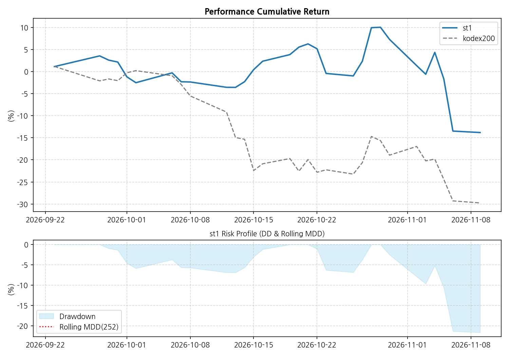
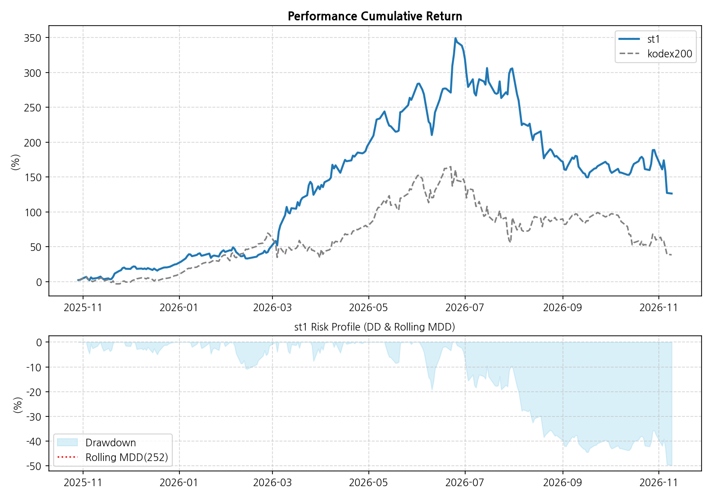
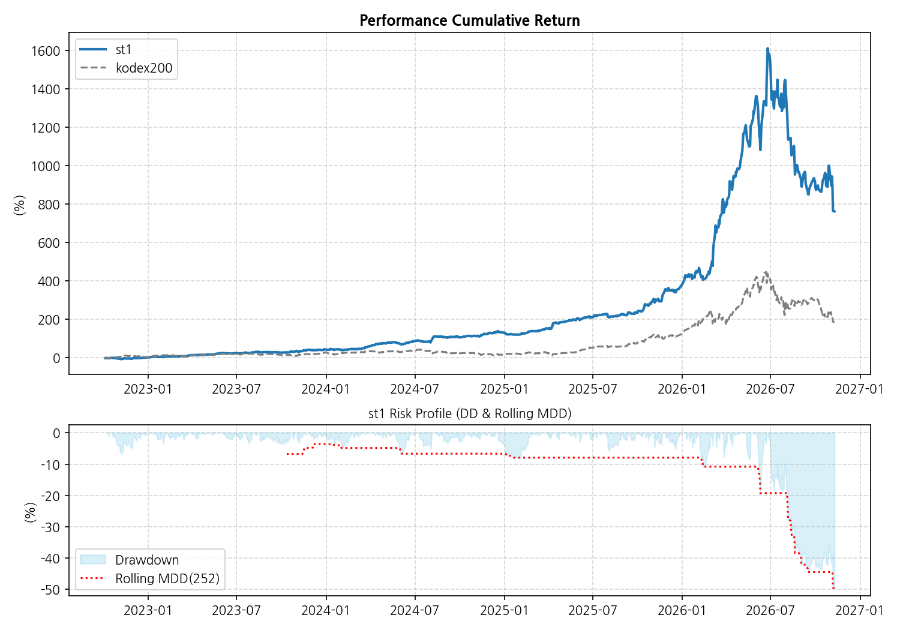

# Strategy Name: st_kodex
### KODEX이용한 기본 투자 

## 📊 Strategy Performance & Risk Report

| 지표 | 전략 1 (S1) | 전략 2 (S2) | 차이 (Diff) |
| :--- | :---: | :---: | :---: |
| **오늘 수익률** | -0.38% | -0.65% | 0.27% |
| **30일 수익률** | -13.81% | -29.75% | 15.94% |
| **1년 수익률** | 126.23% | 38.32% | 87.91% |
| **전체 수익률** | 762.41% | 186.0% | 576.41% |
| **MDD (1Y)** | -49.64% | -47.77% | -1.87%p |
| **MDD (ALL)** | **-49.64%** | **-47.77%** | -1.87%p |
| **샤프 (1Y)** | 1.82 | 0.83 | 0.99 |
| **샤프 (ALL)** | **1.98** | **0.93** | 1.05 |

## 📉 누적 성과 및 리스크 차트
1. **최근 30일:** 
2. **최근 1년:** 
3. **전체 기간:** 
