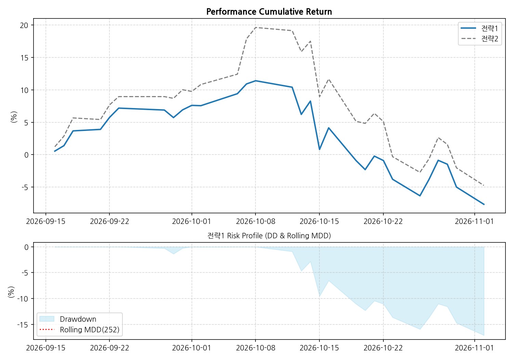
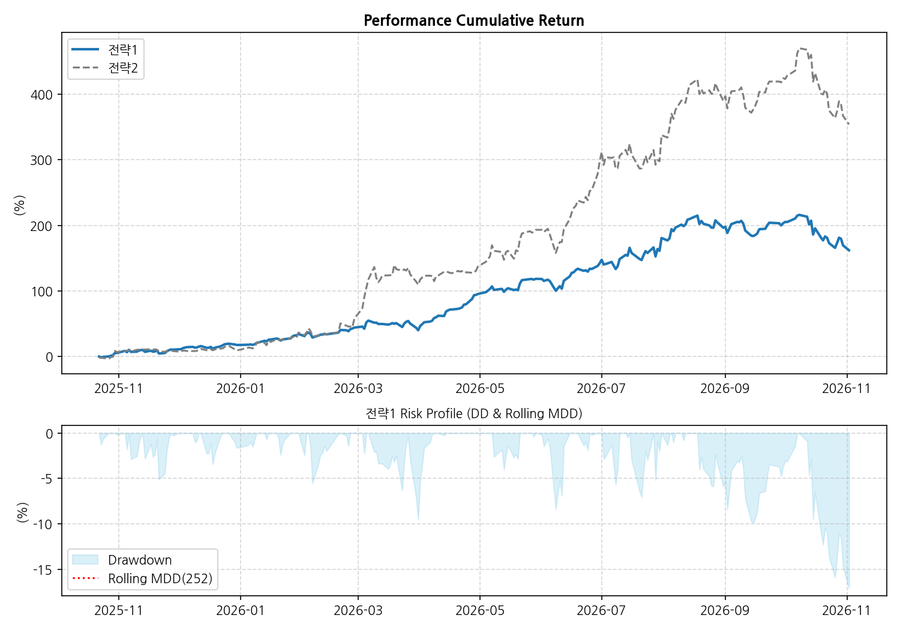
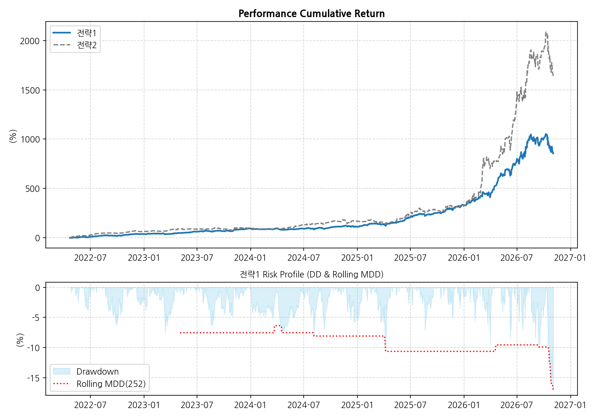

# Strategy Name: bt_stockfuture
###  주식 선물을 활용한 전략입니다. 

## 📊 Strategy Performance & Risk Report

| 지표 | 전략 1 (S1) | 전략 2 (S2) | 차이 (Diff) |
| :--- | :---: | :---: | :---: |
| **오늘 수익률** | -2.8% | -2.77% | -0.03% |
| **30일 수익률** | -7.65% | -4.74% | -2.91% |
| **1년 수익률** | 161.92% | 353.97% | -192.05% |
| **전체 수익률** | 854.42% | 1640.66% | -786.24% |
| **MDD (1Y)** | -17.11% | -20.36% | 3.25%p |
| **MDD (ALL)** | **-17.11%** | **-20.36%** | 3.25%p |
| **샤프 (1Y)** | 3.02 | 3.33 | -0.31 |
| **샤프 (ALL)** | **2.54** | **2.31** | 0.23 |

## 📉 누적 성과 및 리스크 차트
1. **최근 30일:** 
2. **최근 1년:** 
3. **전체 기간:** 
